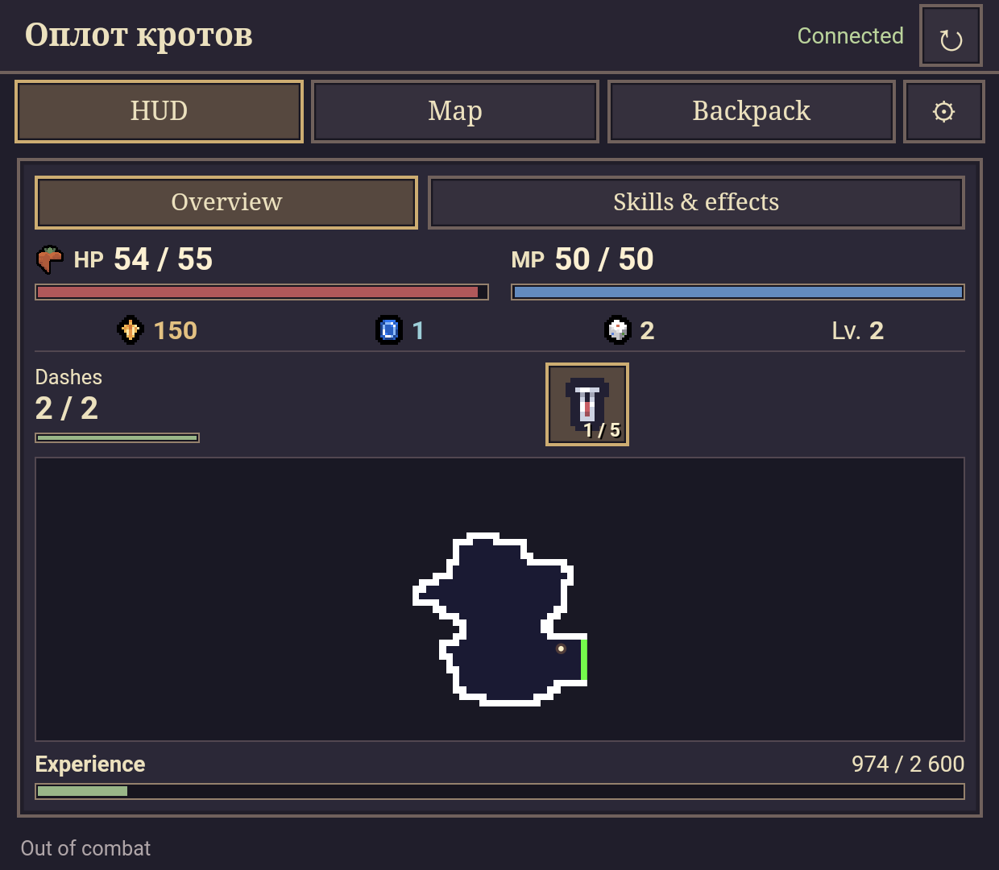
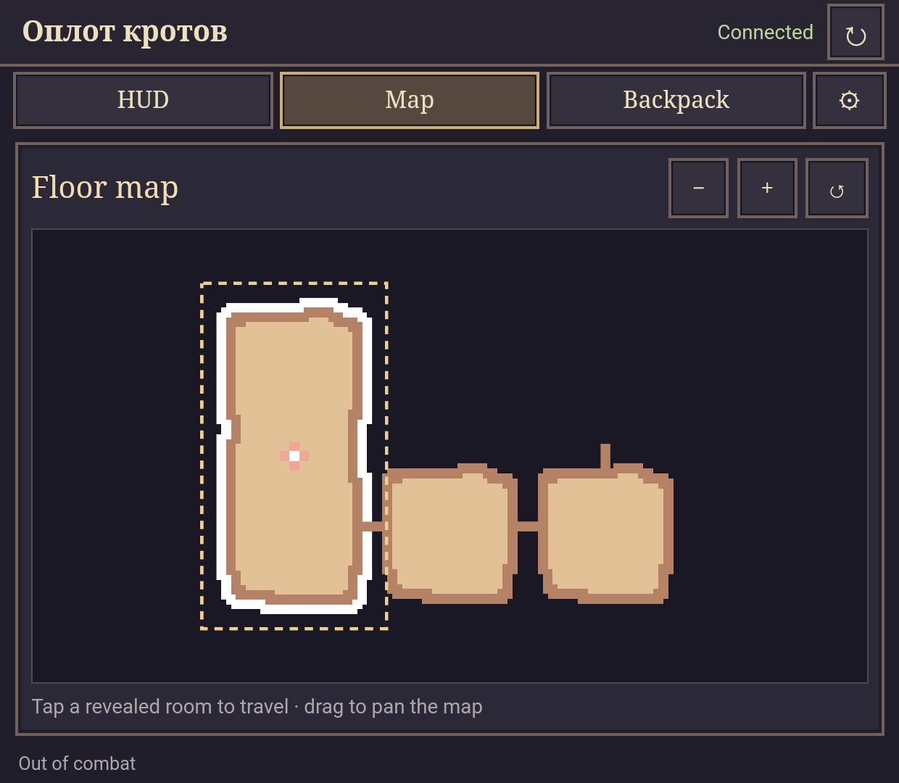
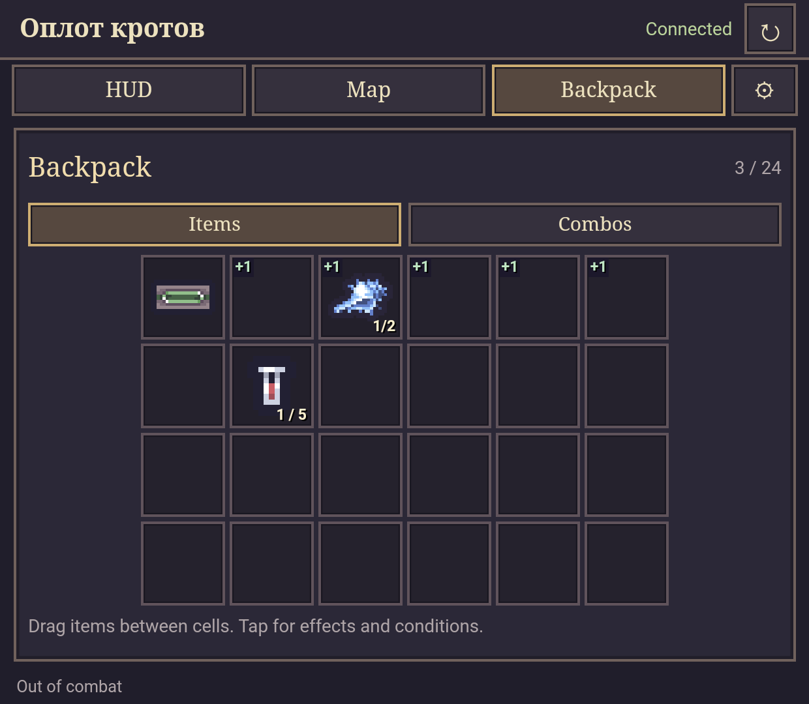
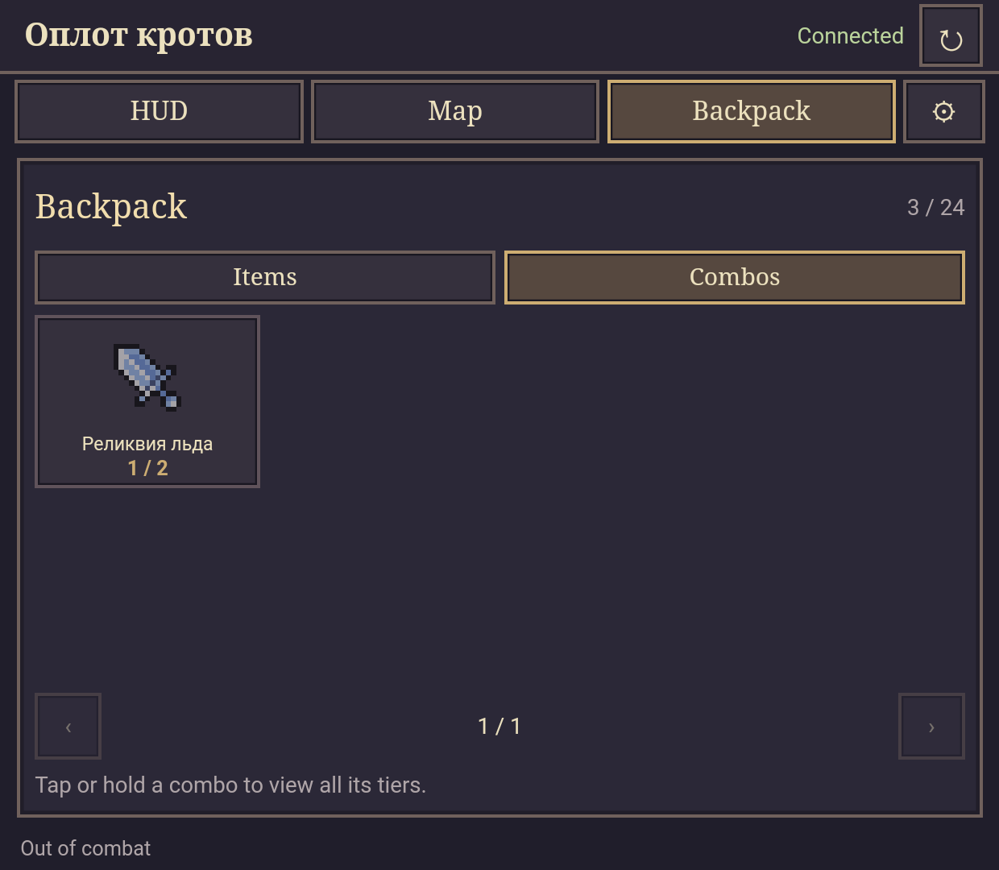

# Sephiria Companion

[English version](README.md)

Приложение-компаньон для **Sephiria** на втором экране, созданное и протестированное на **AYN Thor**. Может подойти и другим двухэкранным Android-портативкам, запускающим совместимую ПК-версию игры локально.

Проект использует **C#** для игрового AddOn и локального HTTP-сервера с событиями, **JavaScript, HTML и CSS** для интерфейса и **Java** для Android-приложения с WebView.

Интерфейс поддерживает **русский и английский**. Названия и описания предметов остаются на языке игры.

## Возможности

- HUD: здоровье, мана, валюта, опыт, рывки, зелья и миникарта комнаты.
- Карта этажа с перемещением между комнатами и анимированным выделением текущей комнаты.
- Рюкзак с перетаскиванием предметов, поворотом табличек и отметками прибавок/штрафов.
- Описания предметов, уровни артефактов и все пороги комбо.

## Скриншоты

Сняты на AYN Thor. Язык игры — русский, интерфейса компаньона — английский.

| HUD | Карта этажа |
| :---: | :---: |
|  |  |
| **Рюкзак** | **Комбо** |
|  |  |

## Установка

1. Скопируй папку **AddOns** из архива релиза в основную директорию игры, рядом с **Sephiria.exe**.
2. Установи **SephiriaCompanion-<version>.apk** на портативку.
3. Запусти Sephiria, загрузи сохранение, открой компаньон и нажми **«Обновить»**.

Нужны Android 8.0+ и совместимая ПК-версия Sephiria со встроенной поддержкой AddOn. Игровое окружение и Android-приложение должны иметь общий доступ к localhost. После замены AddOn перезапусти игру.

## Сборка из исходников

На Windows установи **PowerShell 7**, **.NET SDK 8**, **JDK 17** и **Android SDK** с **платформой android-34** и **Build Tools 34.0.0**. Задай `JAVA_HOME` и `ANDROID_SDK_ROOT`, затем выполни:

```powershell
.\scripts\build.ps1 -GameDirectory "D:\Games\Sephiria"
```

Пути также можно передать параметрами `-JavaHome` и `-AndroidSdk`. Результат: `artifacts/package-<version>/`, APK и ZIP.

Библиотеки игры берутся из установленной копии и не распространяются. При сборке создаётся локальный ключ подписи в `tools/`; сохрани его для последующих обновлений APK. Инструменты, ключи и результаты сборки исключены из Git.

---

Сделано с использованием ИИ — **Codex**.
